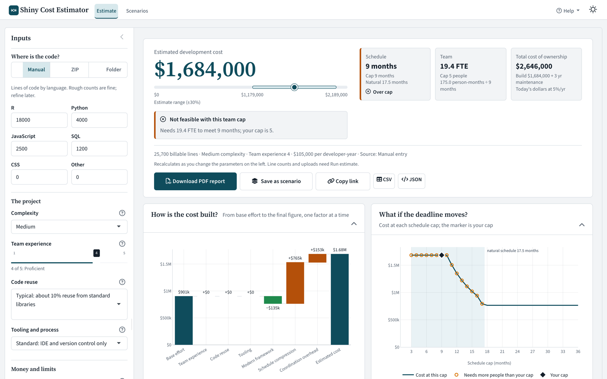
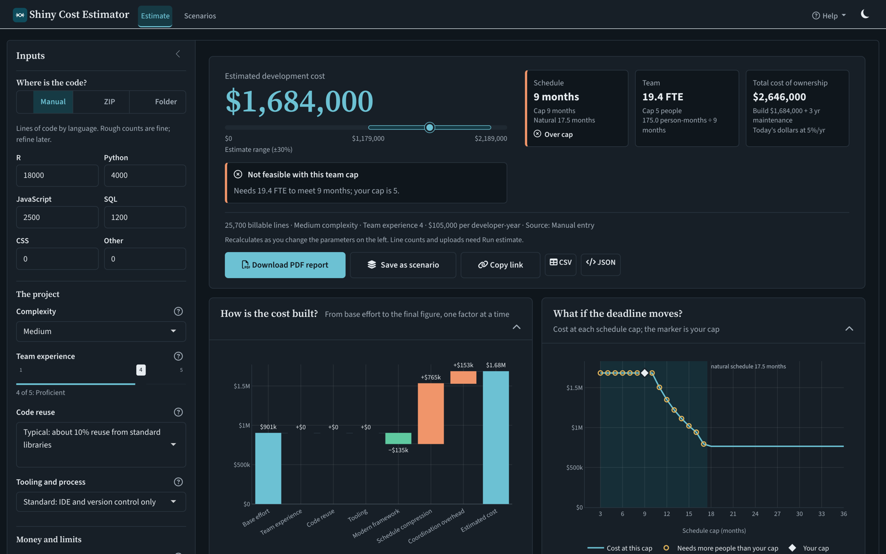
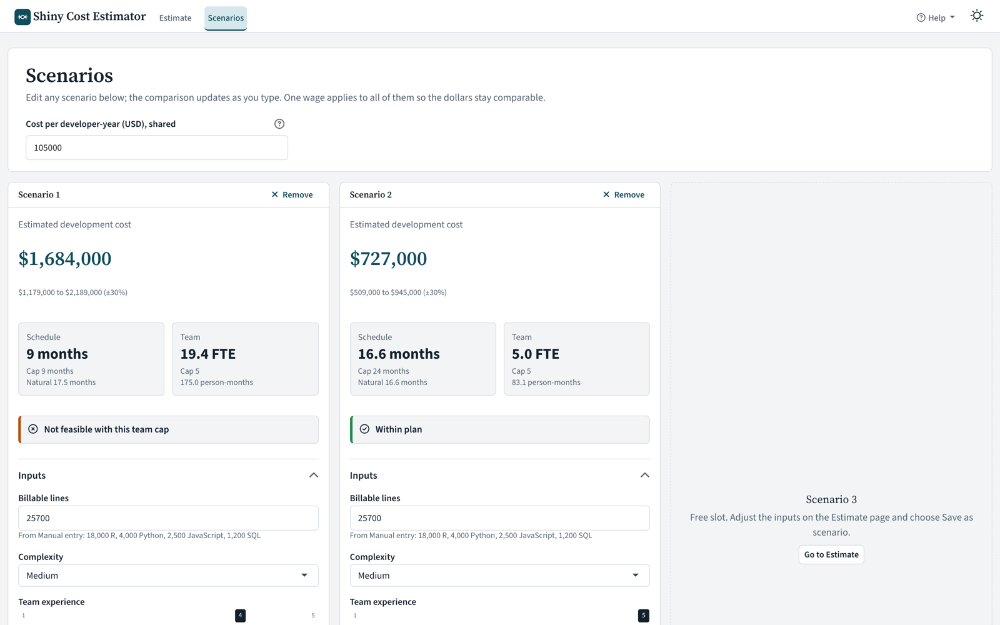
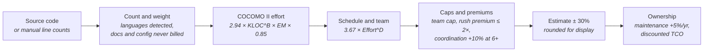
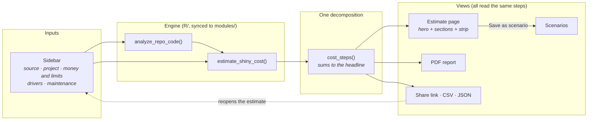

<p align="center">
  
</p>

<h1 align="center">Shiny Cost Estimator</h1>

<p align="center">
  <b>What would it cost to build this software?</b> A number, its honest range, and every assumption behind it.<br>
  COCOMO II cost, schedule, team and total-cost-of-ownership estimates for R Shiny and data-science projects, with a PDF you can forward.
</p>

<p align="center">
  <a href="https://github.com/roldanalex/shiny-app-valuation/actions/workflows/tests.yml"></a>
  <a href="https://alexis-roldan-ds.shinyapps.io/shiny-cost-estimator/"></a>
  
  
  
  
  
  <a href="LICENSE"></a>
</p>

<p align="center">
  <a href="https://alexis-roldan-ds.shinyapps.io/shiny-cost-estimator/">Open the live app</a> ·
  <a href="https://alexis-roldan-ds.shinyapps.io/shiny-cost-estimator/onboarding/index.html">Getting started guide</a> ·
  <a href="#quick-start">Quick start</a> ·
  <a href="#how-the-number-is-built">How it works</a> ·
  <a href="#architecture">Architecture</a>
</p>

<p align="center">
  
</p>

---

## Why this exists

Someone asks what an application would cost to build, rebuild, or keep running. The usual answer is a round number from memory or a spreadsheet nobody can defend. This tool runs the published **COCOMO II** model over your line counts and a handful of plain-language choices, and shows the result as a decision:

- **One figure with its ±30% range**, drawn on a scale from $0 so you can see how wide the uncertainty is.
- **A status in words**: *Within plan*, *Compressed schedule (+18% cost)*, or *Not feasible with this team cap*.
- **Every view tells the same story.** The waterfall, the ranked drivers, the text report, the CSV and the PDF all read one cost decomposition that sums exactly to the headline.
- **A plan advisor** that turns what you know (people, deadline, budget) into exact plans you can apply with one click.
- **Scenarios** you save from the estimate and compare on the same scales; a **share link** that reopens the exact estimate; a **six-page PDF**.

## Quick start

```bash
# 1. Install the R packages (plus the Quarto CLI >= 1.3 if you want PDF reports)
Rscript cost-estimator-app/check_dependencies.R

# 2. Launch
Rscript cost-estimator-app/run_app.R
```

Then choose **Run this example** on the first screen, or type your own line counts and choose **Run estimate**. Line counts and uploads need *Run estimate*; every other input recalculates live.

Prefer the command line? The same engine scans a repository and prints a report:

```r
source("R/repo_code_analyzer.R")
analyze_repo_code(".", avg_wage = 105000, complexity = "medium", team_experience = 4)
```

## What you can do

| | |
|---|---|
| **Three code sources** | Type line counts per language, upload a repository ZIP (50 MB, extracted in an isolated folder with path-traversal checks), or scan a local folder. Documentation and config files are shown but never billed. |
| **Plan advisor** | *What plan should I choose?* Tell it what you know (people, deadline, budget, or nothing) and get exact plans: cheapest, fastest practical, with your team, for your deadline, within budget, each with Apply and Save. A staffing curve shows months by team size, the 75% practical floor and the coordination-overhead zone. Unmet targets are explained (nearest date, scope that fits, levers that close the gap). No AI: every card is an engine call. |
| **Plain-language inputs** | Reuse, tooling and the five COCOMO drivers are named rating levels ("Excellent: IDE, CI/CD, tests, review") mapped to the published multipliers. Every input has a help popover. Reset with Undo. |
| **Question-named sections** | *How is the cost built?* (labelled waterfall) · *What if the deadline moves?* (cost at every cap, marker at yours, shaded compression, hollow infeasible caps) · *Which choices matter most?* · *What is the code made of?* · *How sensitive is the estimate?* · *What does it cost to keep running?* · *Assumptions and data* |
| **Scenarios** | Save up to three estimates from the Estimate page, edit each in place, compare on aligned bars and a table with the cost difference against the baseline. |
| **Share and export** | PDF report (Quarto + Typst, no LaTeX, no Chrome), a link that reopens the exact estimate, CSV and JSON. |
| **Accessible by default** | Light and dark themes from one token set, self-hosted fonts, keyboard focus rings, skip link, reduced-motion support, status never by colour alone, phone layout. |

<p align="center">
  
  
</p>

## How the number is built



| Step | What happens |
|---|---|
| **Count and weight** | Languages are detected and weighted for productivity (SQL 1.3×, JavaScript 0.9×). Markdown, JSON, YAML, SVG and similar files are listed but excluded from billable size. |
| **Effort** | `Effort = 2.94 × KLOC^B × EM_total × 0.85`, where `B` is 1.02 / 1.10 / 1.18 for low / medium / high complexity, `EM_total` is the product of the effort multipliers, and 0.85 is a documented calibration for modern frameworks, applied once. |
| **Schedule and team** | `TDEV = 3.67 × Effort^D` with `D = 0.28 + 0.2 × (B − 0.91)`. Team = effort ÷ schedule, capped at your team cap (never above 8). |
| **Caps and premiums** | A schedule cap below the natural schedule adds a smooth premium `ratio^1.25` (anchored to COCOMO II's SCED driver, capped at 2×). Teams of 6+ carry 10% coordination overhead. A plan that needs more people than the cap is flagged **not feasible**, never silently absorbed. |
| **Range** | ±30% is the typical accuracy of COCOMO II for uncalibrated projects. It is called an estimate range, never a confidence interval. Figures are rounded to the nearest $1,000 above $100,000. |
| **Ownership** | Annual maintenance is a share of the build cost, escalating 5% a year, shown nominal and discounted (default 5%) so the total cost of ownership is in today's dollars. |

The displayed numbers are internally consistent: effort = team × schedule, and the cost steps sum exactly to the headline. Golden-value tests freeze the engine's outputs.

### Inputs

| Input | Choices | Default |
|---|---|---|
| Complexity | Low / Medium / High | Medium |
| Team experience | 1 (novice) to 5 (expert) | 4 |
| Code reuse | Very high reuse … None (0.70 to 1.30) | Typical (1.00) |
| Tooling and process | Excellent … Poor (0.80 to 1.20) | Standard (1.00) |
| Cost per developer-year | $50,000 to $300,000 | $105,000 |
| Team cap | 1 to 8 people | 5 |
| Schedule cap | 3 to 60 months | 24 |
| Reliability, product complexity, reusability, team continuity, domain experience | COCOMO II.2000 rating levels | Nominal (1.00) |
| Maintenance rate / years | 0 to 40% / 0 to 10 years | 20% / 3 |

## Architecture



A larger, annotated version lives in [`docs/diagrams/architecture.drawio`](docs/diagrams/architecture.drawio) (rendered: [`architecture.drawio.png`](docs/diagrams/architecture.drawio.png)).

```
shiny-app-valuation/
├── R/                               # Canonical engine
│   ├── shiny_cost_estimator.R       #   COCOMO II estimation
│   └── repo_code_analyzer.R         #   Repository scanner + CLI report
├── cost-estimator-app/              # The Shiny app (see its README for details)
│   ├── app.R                        #   UI, sidebar, interaction model, URL state
│   ├── modules/
│   │   ├── theme.R                  #   Design tokens: light + dark palettes, fonts
│   │   ├── app_helpers.R            #   Formatting, defaults, rating levels, share link, cost_steps()
│   │   ├── plan_helpers.R           #   Plan advisor: grid, recommendations, staffing curve, narrative
│   │   ├── ui_helpers.R             #   Contract components (KPI, state, section, field, hero)
│   │   ├── analysis_module.R        #   Estimate page results, strip, exports
│   │   ├── comparison_module.R      #   Scenarios
│   │   ├── pdf_report.R             #   Quarto + Typst pipeline
│   │   └── *.R (build artifacts)    #   Synced copies of R/ for deployment
│   ├── report/                      #   PDF template, ggplot2 charts, fonts
│   ├── www/                         #   Stylesheet, fonts, app.js, onboarding page
│   └── markdown/                    #   In-app how-to, user guide, release notes
├── docs/diagrams/                   # draw.io architecture diagram
├── tests/testthat/                  # ~370 assertions across 10 files
└── tools/                           # sync_modules.R, deploy.R
```

**Design tokens.** Every colour lives in `cost-estimator-app/modules/theme.R`, light and dark. bslib, the stylesheet (through generated `--app-*` variables), every plotly chart and the PDF read the same source. **Engine sync.** The copies of the engine under `modules/` are build artifacts refreshed by `Rscript tools/sync_modules.R`; a test fails if they drift.

## Documentation

| For | Read |
|---|---|
| New users | [Getting started guide](https://alexis-roldan-ds.shinyapps.io/shiny-cost-estimator/onboarding/index.html) (why + guided walkthrough with checkpoints; source in [`cost-estimator-app/www/onboarding/`](cost-estimator-app/www/onboarding/)) |
| Inside the app | Help menu: How to use, User guide, Release notes |
| Developers | [`cost-estimator-app/README.md`](cost-estimator-app/README.md) · [`GETTING_STARTED.md`](cost-estimator-app/GETTING_STARTED.md) · [`DEPLOYMENT.md`](cost-estimator-app/DEPLOYMENT.md) |
| What changed | [Release notes](cost-estimator-app/markdown/release_notes.md) |

## Tests

```bash
Rscript tests/testthat.R
```

297 assertions across 9 files: golden-value regressions; model invariants (effort = team × schedule, cost continuity at the schedule cap, exact wage linearity); input validation; analyzer billable classification; display rounding and rating levels; the share-link round trip (identical estimate to the dollar); `cost_steps()` summing exactly to the headline; UI-helper contracts (a KPI needs a reference and n, a state panel needs a reason); a `testServer` smoke test; an end-to-end PDF render; engine/module drift detection. On CI a warning fails the build.

The workflow also runs quality gates before the tests: colours only in `theme.R`, no font CDN, no global assignment, no emoji in UI code, engine copies in sync with `R/`, the onboarding page in sync with its JSON, and one version across `app.R`, the release notes and the README badge. A final step starts the app and checks that it serves the estimate page and the onboarding page.

## Deployment

| Target | How |
|---|---|
| **shinyapps.io** | `Rscript tools/deploy.R` (syncs the engine copies, then deploys `cost-estimator-app/`) |
| **Posit Connect / Shiny Server** | Point at `cost-estimator-app/`; the Folder source hides itself on servers |
| **Docker** | Install R + dependencies and the Quarto CLI, copy the project, expose the Shiny port |

Details, including the Quarto/Typst notes for PDF rendering, are in [`DEPLOYMENT.md`](cost-estimator-app/DEPLOYMENT.md).

### Dependencies

`shiny`, `bslib` (0.12+), `plotly`, `DT`, `markdown`, `jsonlite`, and for the PDF `quarto`, `ggplot2`, `knitr`, `ragg` plus the [Quarto CLI](https://quarto.org) 1.3 or later (Typst is bundled; no LaTeX or Chrome). `testthat` for the tests.

## Contributing

Issues and pull requests are welcome at [github.com/roldanalex/shiny-app-valuation](https://github.com/roldanalex/shiny-app-valuation/issues). Keep the engine changes in `R/`, run `Rscript tools/sync_modules.R`, and make sure `Rscript tests/testthat.R` is green. Colours go in `theme.R`, never inline.

## License

MIT. See [LICENSE](LICENSE).

<p align="center"><sub>Created by Alexis Roldan</sub></p>
